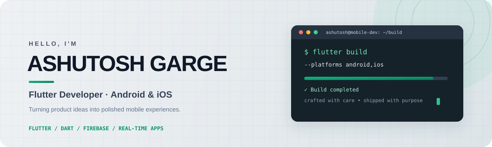

  
  
  

---

## `01` / ABOUT

Flutter developer from **Indore, India**, building Android and iOS apps with polished UI, reliable integrations and maintainable architecture.

- **Focus:** Flutter UI, REST APIs, Firebase and real-time features.
- **Approach:** Clean code, responsive layouts and user-first experiences.
- **Beyond code:** Sketching, chess and cricket.

## `02` / TECH STACK

| Category | Technologies |
|:--|:--|
| **Mobile** | Flutter, Dart, Android, iOS, responsive UI |
| **State management** | GetX, Riverpod, BLoC |
| **Backend & cloud** | Firebase, REST APIs, FastAPI, Python |
| **Real-time & integrations** | Socket.IO, WebSockets, Google Maps, FCM |
| **Payments & storage** | Stripe, Dio, SQLite, SharedPreferences |
| **UI & delivery** | Figma, Syncfusion, fl_chart, Shorebird, GitHub Actions |

## `03` / FEATURED PROJECTS

<table>
<tr>
<td width="50%" valign="top">

### 🛍️ Jayhazmat
**E-Commerce · Mobile**

Shopping app with authentication, product management, cart, checkout and Stripe payments.

`Flutter` `Firebase` `REST API` `Stripe` `GetX`

</td>
<td width="50%" valign="top">

### ✨ LifeVibe AI
**Health & Nutrition · AI**

Food-image analysis, nutrition insights and personalized recommendations with a FastAPI backend.

`Flutter` `Firebase` `FastAPI` `Gemini` `Ollama`

</td>
</tr>
<tr>
<td width="50%" valign="top">

### 📅 MakeItHappn
**Event Management · Mobile**

Create events, suggest dates and vote on the best schedule.

`Flutter` `Firebase` `REST API` `GetX`

</td>
<td width="50%" valign="top">

### 🚚 ASRI — Logistics
**Logistics Marketplace · Mobile**

Multilingual truck bidding, booking management and real-time communication.

`Flutter` `REST API` `Socket.IO` `Localization`

</td>
</tr>
<tr>
<td colspan="2" valign="top">

### 🐾 Shelter App
**Animal Rescue · Mobile**

Location-based platform for reporting injured animals, sharing locations and coordinating rescue efforts.

`Flutter` `Firebase` `Google Maps` `FCM`

</td>
</tr>
</table>

## `04` / BUILD IN PROGRESS

## `05` / EXPERIENCE & EDUCATION

**B.Tech — Electrical & Electronics Engineering**  
Malwa Institute of Technology, Indore · RGPV · 2022 · **CGPA 7.7**

**Certification:** Python (Basic) — HackerRank

## `06` / GITHUB ACTIVITY

## `07` / CONNECT

**Have a Flutter project or opportunity? Let's connect.**

<a href="https://ashutosh-portfolio-rho.vercel.app">Portfolio</a> ·
<a href="https://www.linkedin.com/in/ashutosh-garge-3037a5240">LinkedIn</a> ·
<a href="mailto:ashutoshgarge123@gmail.com">Email</a>

Designed with focus · Built with Flutter · Shipped with care

