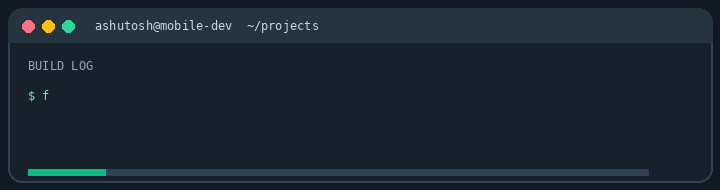

 

  

 

---

## `01` / ABOUT ME

### 👨‍💻 Flutter Developer · Mobile Application Engineer

Building polished Android and iOS applications with reliable integrations and maintainable architecture.

| | |
|:--|:--|
| 📍 **Location** | Indore, Madhya Pradesh, India |
| 📱 **Specialization** | Flutter, Dart, Android & iOS |
| ⚡ **Interests** | Real-time apps, Firebase, REST APIs and AI products |
| ♟️ **Beyond code** | Sketching, chess and cricket |

---

## `02` / TECH STACK

  

| **Area** | **Technologies** |
|:--|:--|
| 📱 **Mobile Development** | Flutter, Dart, Android, iOS, Responsive UI |
| 🧩 **State Management** | GetX, Riverpod, BLoC |
| ☁️ **Backend & Cloud** | Firebase, REST APIs, FastAPI, Python |
| ⚡ **Real-Time & Maps** | Socket.IO, WebSockets, Google Maps, FCM |
| 💳 **Payments & Networking** | Stripe, Dio, HTTP, JSON |
| 💾 **Local Storage** | SQLite, SharedPreferences |
| 🎨 **UI & Charts** | Figma, Syncfusion, fl_chart |
| 🚀 **Deployment & CI/CD** | Shorebird, GitHub Actions, Play Console, App Store Connect |

---

## `03` / FEATURED PROJECTS

### 🚀 SELECTED MOBILE APPLICATIONS

Building practical products across different industries.

<table>
<tr>
<td width="50%" valign="top">

<h3>🛍️ Jayhazmat</h3>

**E-Commerce Application**

Shopping app with authentication, product management, cart, checkout and Stripe payment integration.

**Key Features**
- Authentication and product management
- Shopping cart and checkout
- Stripe payment integration

**Technology**

</td>
<td width="50%" valign="top">

<h3>✨ LifeVibe AI</h3>

**AI Health & Nutrition**

Food-image analysis, nutrition insights and personalized recommendations with an AI-enabled backend.

**Key Features**
- Food image analysis
- Nutrition insights
- Personalized recommendations

**Technology**

</td>
</tr>

<tr>
<td width="50%" valign="top">

<h3>📅 MakeItHappn</h3>

**Event Management Application**

Event planning app that helps users create events, suggest dates and vote on the best schedule.

**Key Features**
- Event creation and management
- Date suggestions
- Voting and scheduling

**Technology**

</td>
<td width="50%" valign="top">

<h3>🚚 ASRI — Logistics</h3>

**Logistics Marketplace**

Multilingual logistics platform for truck bidding, booking management and real-time communication.

**Key Features**
- Truck bidding and booking
- Real-time communication
- Multilingual support

**Technology**

</td>
</tr>

<tr>
<td colspan="2" valign="top">

<h3>🐾 Shelter App</h3>

**Animal Rescue Platform**

Location-based platform for reporting injured animals, sharing locations and coordinating rescue efforts.

**Key Features**
- Injured animal reporting
- Location sharing
- Rescue coordination and notifications

**Technology**

</td>
</tr>
</table>

---

## `04` / DEVELOPER WORKFLOW

 

**PLAN → DEVELOP → INTEGRATE → TEST → SHIP**

---

## `05` / EDUCATION & CERTIFICATION

| 🎓 Qualification | Institution | Year | Result |
|:--|:--|:--:|:--:|
| **B.Tech — Electrical & Electronics Engineering** | Malwa Institute of Technology, RGPV | 2022 | **7.7 CGPA** |
| **Python (Basic) Certification** | HackerRank | — | Certified |

---

## `06` / GITHUB ACTIVITY

  

  

---

## `07` / LET'S CONNECT

### 🤝 HAVE A FLUTTER PROJECT OR OPPORTUNITY?

**Let's connect and build something meaningful.**

 

  

Designed with focus · Built with Flutter · Shipped with care

